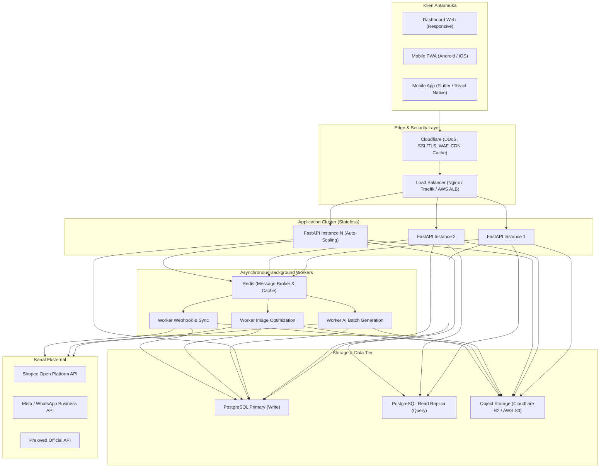

# Cetak Biru Pengembangan Skala Besar: SellFlow Enterprise & Cloud Platform

Dokumen ini adalah panduan arsitektur strategis dan teknis untuk mentransformasikan **SellFlow Automation** dari aplikasi katalog mandiri (*single-user local MVP*) menjadi **platform multi-kanal skala perusahaan (*enterprise multi-tenant platform*)** yang mampu melayani ribuan penjual, menangani jutaan listing, dan berjalan 24/7 di infrastruktur cloud.

---

## 1. Visi Arsitektur Skala Besar (Enterprise Architecture)



---

## 2. Peta Jalan Pengembangan Lanjutan (Advanced Roadmap)

### Fase A: Multi-Tenancy & Manajemen Tim (Multi-User RBAC)
*Saat ini sistem dirancang untuk 1 pemilik toko. Untuk menjadi platform komersial besar, sistem perlu mendukung banyak toko sekaligus.*

1. **Skema Multi-Tenant**:
   - Menambahkan tabel `organizations` (toko/badan usaha) dan `user_organizations`.
   - Menambahkan kolom `organization_id` pada setiap tabel utama (`products`, `listings`, `inventory_events`, `ai_drafts`).
   - Setiap query database wajib memfilter berdasarkan `organization_id` pengguna yang sedang login untuk isolasi data 100%.
2. **Role-Based Access Control (RBAC)**:
   - **Owner / Pemilik**: Akses penuh, pengaturan rekening, pengelolaan staf, dan akses laporan keuangan omzet.
   - **Admin / Staff Gudang**: Mengelola stok fisik, upload foto, dan menandai barang terjual.
   - **Copywriter / Marketer**: Mengelola draft copywriting AI dan mempublikasikan listing ke kanal penjualan.
3. **Autentikasi Enterprise**:
   - Migrasi dari session cookie ke **JWT (JSON Web Tokens)** dengan sistem Access Token (umur pendek 15 menit) dan Refresh Token (umur panjang 7 hari tersimpan terenkripsi di database).
   - Dukungan login Single Sign-On (Google OAuth, Apple ID).

---

### Fase B: Infrastruktur Cloud & Object Storage Terdistribusi
*Menghapus ketergantungan pada penyimpanan berkas di disk laptop.*

1. **Migrasi Penyimpanan Gambar ke S3 / Cloudflare R2**:
   - Mengganti modul [`backend/storage.py`](file:///C:/Users/Ardi/OneDrive/Dokumen/sellflow-automation/backend/storage.py) dengan driver S3-compatible SDK (`boto3` atau `aiobotocore`).
   - Menggunakan **Presigned Upload URLs**: Foto diunggah langsung dari browser pengguna ke Cloudflare R2 / AWS S3 tanpa membebani bandwidth server backend.
   - **Image Optimization Pipeline**: Mengonversi setiap foto secara otomatis ke format WebP terkompresi dengan 3 resolusi: Thumbnail (150x150), Preview (600x600), dan High-Res (1200x1200).
2. **Database Cloud Terkelola**:
   - Menjalankan PostgreSQL terkelola (AWS RDS, Supabase, Neon, atau Railway).
   - Menyiapkan **PgBouncer** untuk database connection pooling agar dapat melayani ribuan koneksi konkuren tanpa kehabisan memori.

---

### Fase C: Asynchronous Task Queue (Worker Skala Tinggi)
*Menghindari beban proses berat pada request web HTTP.*

1. **Integrasi Celery / ARQ dengan Redis**:
   - Mengeluarkan proses lambat dari siklus request HTTP:
     - Pembuatan teks AI massal (*bulk generation* untuk puluhan produk sekaligus).
     - Kompresi foto resolusi tinggi.
     - Panggilan API ke marketplace eksternal.
     - Notifikasi Webhook.
2. **Retry Mechanism & Dead Letter Queue (DLQ)**:
   - Sistem retry otomatis dengan *exponential backoff* jika API eksternal sedang mengalami *rate limit* atau gangguan jaringan sementara.

---

### Fase D: Integrasi API Resmi & Otomatisasi 2 Arah (*Two-Way Sync*)

1. **Shopee Open Platform (OAuth2 & Webhook)**:
   - Mendaftarkan aplikasi di Shopee Open Platform Console.
   - Implementasi alur otorisasi toko via OAuth2 (penyimpanan `access_token` dan auto-refresh via `refresh_token`).
   - **Webhook Listener**: Menerima notifikasi otomatis dari Shopee saat terjadi transaksi penjualan, sehingga stok di SellFlow otomatis terpotong detik itu juga.
2. **WhatsApp Business API**:
   - Mengirimkan draf postingan langsung ke nomor WhatsApp admin/tim toko.
   - Mengirim notifikasi otomatis ke pembeli saat nomor resi pengiriman dimasukkan.
3. **Kanal Tambahan**:
   - Tokopedia / TikTok Shop Open API.
   - Integrasi Website Toko Online Mandiri (Shopify / WooCommerce adapter).

---

### Fase E: Kecerdasan Buatan (AI) Generasi Lanjutan

1. **Vision AI (Analisis Gambar Otomatis)**:
   - Penjual cukup mengunggah 1 foto produk tanpa mengetik.
   - Vision AI (Google Gemini Vision API) otomatis mendeteksi:
     - Kategori barang (misal: "Jaket Kulit Pria").
     - Merek yang terbaca pada label.
     - Warna dominan dan estimasi ukuran.
     - Deteksi noda atau cacat visual pada foto secara otomatis.
2. **Smart Pricing Recommendation (AI Penentu Harga)**:
   - Menganalisis riwayat transaksi lampau di database untuk merekomendasikan harga jual optimal agar barang cepat laku dengan keuntungan terbaik.
3. **Laporan & Akuntansi Preloved**:
   - Menambahkan kolom `HPP / Modal Beli` pada produk.
   - Menampilkan laporan laba bersih riil (*Net Profit*) per kanal penjualan.

---

### Fase F: Aplikasi Mobile Native & PWA

1. **Progressive Web App (PWA)**:
   - Menambahkan berkas `manifest.json` dan *service worker*.
   - Aplikasi dapat diinstal langsung ke homescreen smartphone Android/iPhone seperti aplikasi native tanpa perlu Play Store.
2. **Aplikasi Mobile (Flutter / React Native)**:
   - Mengakses kamera ponsel secara langsung untuk foto produk preloved dari berbagai sudut (*multi-angle shot*).
   - Kompresi foto langsung di perangkat (*on-device compression*) sebelum diunggah untuk menghemat kuota internet penjual.

---

## 3. Estimasi Struktur Folder Proyek Skala Besar

```
sellflow-enterprise/
├── .github/workflows/          # CI/CD pipeline (lint, test, auto-deploy)
├── alembic/                    # Database migrations
├── apps/
│   ├── api/                    # FastAPI Main Application
│   │   ├── routers/            # Modular routes (auth, products, media, ai, publish, webhooks, analytics)
│   │   ├── services/           # Business logic layer
│   │   ├── models/             # SQLAlchemy multi-tenant models
│   │   ├── schemas/            # Pydantic v2 validation contracts
│   │   └── core/               # Security, database sessions, config
│   ├── workers/                # Celery / ARQ background tasks
│   │   ├── tasks_ai.py         # AI batch processing
│   │   ├── tasks_media.py      # Image resizing & CDN upload
│   │   └── tasks_sync.py       # Two-way marketplace sync
│   └── web/                    # Modern frontend (React/Next.js atau PWA)
├── docker/
│   ├── Dockerfile.api
│   ├── Dockerfile.worker
│   └── docker-compose.prod.yml
├── kubernetes/                 # K8s manifests / Helm charts (opsional untuk hyper-scale)
├── docs/                       # Dokumentasi arsitektur, API spec, dan SOP operasional
└── pyproject.toml              # Dependency & tool configurations
```

---

## 4. Panduan Menjaga Kualitas Kode Saat Tim Membesar
- **Zero Hallucination Principle**: Selalu pertahankan aturan bahwa AI tidak boleh mengarang kondisi fisik barang preloved.
- **Strict Linting & Typing**: Terapkan `mypy` untuk static type checking dan `ruff` untuk linting otomatis pada setiap Git pull request.
- **Automated Regression Testing**: Pertahankan cakupan tes di atas 85% untuk setiap endpoint API baru.
- **Audit Keamanan Rutin**: Jalankan `pip-audit` atau `dependabot` untuk memindai celah keamanan pada dependensi secara berkala.
