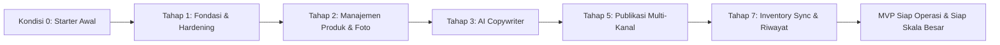

# Dokumentasi Perkembangan Proyek: SellFlow Automation (0 — Selesai Fondasi MVP)

Dokumen ini mencatat seluruh riwayat pembangunan, keputusan arsitektur, dan pencapaian teknis **SellFlow Automation** dari kondisi awal (*starter/prototype*) hingga menjadi aplikasi katalog preloved multi-kanal yang utuh, aman, dan siap pakai.

---

## 1. Latar Belakang & Masalah Awal (Kondisi 0)
- **Tantangan Pengguna**: Pengguna mengelola barang preloved (barang bekas berkualitas, stok unik 1 unit per barang) dan menjualnya di tiga kanal utama: **Shopee**, **Facebook Group**, dan **Aplikasi Preloved**. Menginput ulang judul, deskripsi, harga, dan foto pada tiga platform memakan banyak waktu dan rentan terjadi kesalahan stok ganda (barang sudah laku di satu tempat tapi masih dipesan di tempat lain).
- **Kondisi Awal Repositori**:
  - Hanya berupa starter prototipe dasar.
  - Autentikasi masih membaca string mentah dari environment tanpa database pengguna.
  - Tidak ada tes otomatis (*0 tests*).
  - Skema database belum memiliki sistem migrasi (*no migrations*).
  - Belum ada antarmuka input produk, belum ada sistem upload foto, dan belum ada modul AI maupun publikasi.

---

## 2. Linimasa Perkembangan per Tahapan



### Tahap 1 — Fondasi, Keamanan & Pengujian Otomatis
* **Fokus**: Hardening keamanan autentikasi dan membangun fondasi database migration.
* **Pencapaian Teknis**:
  - **Tabel User & Password Hashing**: Menggantikan perbandingan string mentah dengan tabel `users` di database yang dienkripsi menggunakan algoritma **Argon2id** via pustaka `pwdlib`. Akun admin pertama otomatis di-seed secara aman.
  - **Proteksi Brute-Force Rate Limiting**: Membatasi percobaan login maksimal 5 kali gagal dalam jendela waktu 5 menit; percobaan ke-6 otomatis diblokir dengan HTTP 429 *Too Many Requests*.
  - **Perlindungan CSRF Modern**: Mengimplementasikan middleware W3C Fetch Metadata (`Sec-Fetch-Site: cross-site`) yang menolak upaya *cross-site request forgery* pada request state-changing (`POST`, `PUT`, `PATCH`, `DELETE`) dengan HTTP 403.
  - **Migrasi Database Alembic**: Mengonfigurasi Alembic untuk mengelola evolusi skema tabel secara terstruktur.
  - **Pengujian Otomatis**: Membangun pengujian unit/integrasi dengan `pytest` (7 tes awal lulus 100%).

### Tahap 2 — Manajemen Produk Preloved & Upload Foto Aman
* **Fokus**: Memberikan antarmuka katalog produk lengkap dan penanganan berkas foto.
* **Pencapaian Teknis**:
  - **Atribut Khusus Preloved**: Memperluas tabel `Product` dengan kolom `category`, `brand`, `size`, `condition`, `defects` (catatan minus/cacat), dan `updated_at`.
  - **Tabel & Relasi Foto**: Membuat tabel `ProductImage` dengan pelacakan foto utama (`is_primary`) dan pengurutan (`order`).
  - **Validasi Keamanan Upload**:
    - Validasi ekstensi (`.jpg`, `.jpeg`, `.png`, `.webp`) dan batas ukuran berkas (maks. 10 MB per foto).
    - Validasi **Magic Bytes / File Signature** (mencegah penyamaran script jahat berkedok gambar).
    - Penamaan berkas acak UUID hex dan verifikasi *path containment* anti *path traversal*.
  - **Antarmuka UI**: Tampilan kartu produk (*product card*), modal tambah/edit produk, dan modal galeri foto (*drag-and-drop*).

### Tahap 3 — Generator Copywriting AI Profesional
* **Fokus**: Membantu penjual meracik teks penawaran yang efektif tanpa mengorbankan kejujuran kondisi barang.
* **Pencapaian Teknis**:
  - **Prinsip Kejujuran & Profesional**: Prompt sistem yang sangat ketat melarang AI mengarang kelengkapan, garansi, atau klaim kualitas tanpa dasar (*"100% original"*). Jika produk memiliki catatan cacat/minus, AI wajib menyebutkannya secara transparan dan sopan.
  - **Dual Engine Provider**:
    - **Google Gemini Engine**: Model `gemini-2.5-flash` jika API key diisi.
    - **Built-in Rule Engine**: Generator deterministik cerdas bawaan yang berjalan instan tanpa biaya token (Rp 0) dan tanpa dependensi jaringan eksternal.
  - **Format Khusus per Kanal**:
    - **Shopee**: Judul ramah keyword pencarian (maks. 120 karakter), deskripsi berpoin rapi, dan tagar relevan.
    - **Facebook Group**: Gaya ramah komunitas jual-beli (`[WTS] ...`), harga transparan, dan ajakan PM/chat sopan.
    - **Aplikasi Preloved**: Format ringkas yang mengutamakan transparansi kondisi fisik dan ukuran.
  - **Human-in-the-Loop**: Draft dapat diedit langsung oleh pengguna, disetujui (*Approve*), dan disalin instan (*Copy to Clipboard*).

### Tahap 5 — Publikasi Multi-Kanal (Assisted Posting yang Sah)
* **Fokus**: Menyediakan distribusi listing yang mematuhi kebijakan platform dan aman dari pemblokiran akun.
* **Pencapaian Teknis**:
  - **Assisted Posting Meta/Facebook**: Solusi resmi menghadapi kebijakan penutupan Groups API oleh Meta (April 2024). Sistem menyusun paket posting siap pakai (teks + foto + link grup langsung) agar penjual dapat mempublikasikannya secara manusiawi tanpa risiko akun diblokir.
  - **Tabel Listing Multi-Kanal**: Memperluas tabel `Listing` untuk melacak status terbit di Shopee, Facebook Group, dan Preloved lengkap dengan tautan postingan aktif (*external_url*) dan tanggal terbit.
  - **Modal Paket Posting**: Panduan langkah interaktif, tombol akses cepat ke platform, dan formulir konfirmasi URL listing.

### Tahap 7 — Inventory Sync, Alur Barang Terjual & Riwayat
* **Fokus**: Mencegah pesanan ganda (*overselling*) dan menyediakan laporan transaksi.
* **Pencapaian Teknis**:
  - **Alur Tandai Terjual**: Tombol sekali klik saat barang laku, mencatat kanal transaksi (Facebook, Shopee, Preloved, COD/Offline), harga deal akhir, dan catatan pembeli.
  - **Pengurangan Stok Otomatis**: Stok otomatis diset menjadi 0 dan status produk diubah menjadi `sold`.
  - **Pengingat Penarikan Listing (*Cross-Channel Unpublish Checklist*)**: Sistem mendeteksi kanal lain tempat produk tersebut masih tayang dan memunculkan modal peringatan penarikan dengan tombol *"Tandai Ditarik"*.
  - **Tabel & Audit Log InventoryEvent**: Mencatat seluruh riwayat transaksi penjualan.
  - **Menu Riwayat Penjualan**: Dashboard analitik yang menghitung akumulasi barang terjual, total omzet rupiah, analisis kanal paling laris, serta tabel histori transaksi lengkap.

---

## 3. Matriks Hasil Pengujian Otomatis Akhir

Seluruh 13 tes pengujian otomatis lolos 100%:
```text
tests/test_ai.py::test_ai_copy_generator_facts_preservation PASSED       [  7%]
tests/test_ai.py::test_ai_endpoints_workflow PASSED                      [ 15%]
tests/test_api.py::test_password_hashing PASSED                          [ 23%]
tests/test_api.py::test_health PASSED                                    [ 30%]
tests/test_api.py::test_session_unauthenticated PASSED                   [ 38%]
tests/test_api.py::test_dashboard_unauthorized PASSED                    [ 46%]
tests/test_api.py::test_csrf_blocking PASSED                             [ 53%]
tests/test_api.py::test_login_rate_limiting PASSED                       [ 61%]
tests/test_api.py::test_login_and_product_flow PASSED                    [ 69%]
tests/test_inventory.py::test_inventory_sync_and_sales_history PASSED    [ 76%]
tests/test_products.py::test_product_crud_flow PASSED                    [ 84%]
tests/test_products.py::test_image_upload_security_validation PASSED     [ 92%]
tests/test_publish.py::test_publish_package_and_assisted_posting_workflow PASSED [100%]
```

---

## 4. Status Saat Ini
Aplikasi SellFlow Automation telah berada pada status **MVP Lengkap & Terverifikasi**. Seluruh menu di sidebar (**Dashboard**, **Produk**, **Publikasi**, **Riwayat**) berfungsi secara terintegrasi dan siap digunakan untuk kegiatan bisnis harian.
